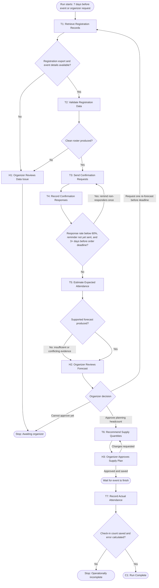

# Workflow of Tasks

## 1. Workflow Overview

### 1.1 Workflow Goal

This workflow supports the system goal defined in `my_first_agent/README.md`.

### 1.2 Workflow Trigger

A planning run starts automatically seven days before the scheduled AI Hackathon, or earlier when a CPVC organizer selects **Start Attendance Forecast** after registration opens. The organizer must first enter the event details (date, start time, venue capacity, and the supply-order deadline) and connect the registration export. Only one planning run may be active per event; a second trigger while a run is active is recorded as skipped rather than starting a duplicate run that could message registrants twice. Actual attendance is recorded by the same run after the event, when the organizer uploads or confirms the event check-in list.

### 1.3 Completion Condition at Runtime

The run is **complete** when (1) an organizer has approved a planning headcount and supply plan that are saved to the event planning sheet, and (2) after the event, the actual checked-in attendance and the forecast error have been recorded against that approved headcount. The run **stops awaiting an organizer** when the forecast, supply plan, or a data problem is waiting for organizer review. It stops **operationally incomplete** when a required read, message send, or save failed and could not be confirmed. A run is never counted as complete just because messages were sent or a forecast was produced; it needs the organizer's approval and the recorded actual attendance.

### 1.4 General Workflow

The system first performs **T1: Retrieve Registration Records** to load the current registration export, the event details, and CPVC's prior event attendance history. **T2: Validate Registration Data** removes duplicate and test registrations, flags incomplete records, and produces a clean roster; if the roster cannot be validated (for example, the export is unreadable or most records are missing contact information), the case goes to **H1: Organizer Reviews Data Issue** and the run pauses. With a clean roster, **T3: Send Confirmation Requests** sends each registrant one short message asking whether they still plan to attend (Yes / Maybe / No), and **T4: Record Confirmation Responses** logs every reply with a timestamp. If fewer than 60% of registrants have responded after 48 hours and at least three days remain before the supply-order deadline, the workflow loops back to T3 once to send a single reminder to non-responders only. No registrant ever receives more than two messages, and anyone who replies "No" or opts out receives nothing further.

**T5: Estimate Expected Attendance** then combines the confirmation responses, the non-response rate, and historical attendance rates to produce an expected headcount with a low–high range and a confidence note. If the evidence is too thin or contradictory for a supported estimate, T5 hands the case to an organizer instead of guessing. Every forecast goes to **H2: Organizer Reviews Forecast**, where an organizer approves or adjusts the planning headcount; an organizer may also request one re-forecast if new registrations or responses arrive before the order deadline. **T6: Recommend Supply Quantities** converts the approved headcount into food, drink, and swag quantities with a stated buffer, and **H3: Organizer Approves Supply Plan** approves it before anything is purchased; HackTrack never places orders itself. After the event, **T7: Record Actual Attendance** compares the check-in count with the approved planning headcount and saves the forecast error so CPVC can measure progress toward the goal and improve the next event's history.

### 1.5 Workflow Diagram

